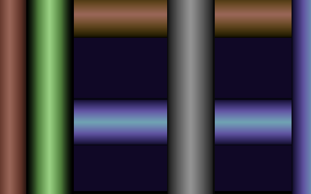

# rosetta-slop

Rosetta Code tasks implemented for the fun of it, starting with the
**[Raster bars](https://rosettacode.org/wiki/Raster_bars)** draft task.

## Raster bars (microScript 2.0)



A demoscene classic: metallic-looking horizontal **and** vertical raster
bars swaying across a dark background, done the way a C64 would do it —
one 1-pixel strip per raster line, with a per-raster color gradient.

- Runs on [microStudio](https://microstudio.dev) (microScript 2.0):
  paste `src/ms/main.ms` into a new project and hit play.
- Every color ramp interpolates between measured **VIC-II "Pepto" PAL**
  palette entries, with a specular sheen (`sqrt(4u(1-u))`) faking the
  chrome highlight at the bar's core.
- 5 horizontal bars sway up/down and 4 vertical bars sway left/right,
  each on its own sinusoid.

### Headless tests

The repo vendors the microStudio v2 engine and runs the demo headlessly
in Node (same recipe as my `mine-demake` project):

```bash
node test/rasterbars.js
```

The test parses all sources with the real v2 parser, drives
`init`/`update`/`draw`, renders PNG snapshots into `test/snapshots/`,
and asserts that bars actually move, all drawn colors are well-formed,
and adjacent raster strips change color gradually (smooth gradient).
